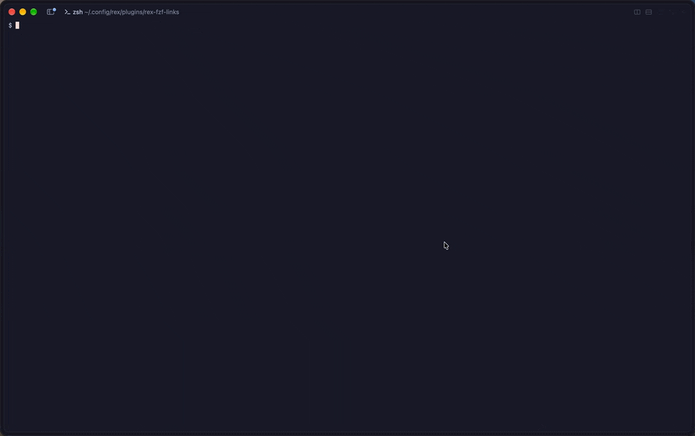

# rex-fzf-links

[](https://github.com/daehyeok/rex-fzf-links/actions/workflows/test.yml)

Fuzzy-pick the links in a [Rex](https://www.superlogical.com/rex) terminal pane with [fzf](https://github.com/junegunn/fzf), see each one highlighted where it was printed, and open or copy it with one key, from local and remote ssh panes alike.



## Features

- **fzf search:** fuzzy-filter every URL, file path and custom link in the pane, newest first.
- **The link in context:** the preview shows the pane's text around the selected link, with its line marked and the link highlighted. Put it above, below or beside the list.
- **Full context view:** `ctrl-o` opens the whole pane text in `less` at that link.
- **One-key open:** `alt-1` … `alt-9` open the Nth visible row, and the numbers follow as you scroll. `enter` opens, `ctrl-y` copies, and ⌘-click works too.
- **Custom links:** turn `ENG-123`, `#42` or app URLs into links with a Lua pattern.
- **Remote panes, opened on your Mac:** links in ssh panes open in your Mac's browser and clipboard, through the Rex app's own connection, with no extra ssh login.

## Requirements

- The **macOS Rex app** as your client. Links open with `open` and copy with `pbcopy`; to use other tools, set [`open_cmd` and `copy_cmd`](#open_cmd-and-copy_cmd).
- On the host each pane runs on: `sh`, `awk`, `less` and [fzf](https://github.com/junegunn/fzf) 0.46 or newer (tested with 0.74 and 0.75), on the `PATH` your terminals have there: the picker starts through your shell and reads its startup files, `~/.zshrc` included (see `interactive_shell`).

## Quick start

1. Clone the plugin into your Rex config:

   ```sh
   git clone https://github.com/daehyeok/rex-fzf-links ~/.config/rex/plugins/rex-fzf-links
   ```

2. Set it up and bind keys in `~/.config/rex/init.lua`:

   ```lua
   require("plugins.rex-fzf-links").setup({})

   rex.bind("alt+u", "pick_link")            -- show the picker
   rex.bind("alt+shift+u", "open_last_link") -- open the newest link, no picker
   ```

3. Reload: `rex config reload`.

Press `alt+u` in any pane. Both actions are also in the command palette ("Pick a Link in Pane", "Open Newest Link in Pane"). They work on the focused pane; when it has no links, a small message says so.

To update later: `git -C ~/.config/rex/plugins/rex-fzf-links pull && rex config reload`.

### With Amber

With [Amber](https://github.com/rawnly/amber) installed first, skip the clone and declare the plugin in `~/.config/rex/init.lua`:

```lua
local amber = dofile(os.getenv("HOME") .. "/.local/share/rex/amber/amber.lua")

amber.setup({
  plugins = {
    { "daehyeok/rex-fzf-links", main = "fzf_links" },
  },
})
```

Then run `amber install`. It installs the plugin and reloads Rex; loading the config alone never installs. Add the `rex.bind` lines from step 2 as well.

## Keys

| Key | Does |
|---|---|
| type | filter the links (fuzzy, case-insensitive) |
| `up` / `down`, `ctrl-p` / `ctrl-n` | move; past the last or first row, scroll by one |
| `page-up` / `page-down` | scroll by a screenful |
| `enter` | open the highlighted link |
| `alt-1` … `alt-9` | open the Nth visible row |
| `ctrl-y` | copy the highlighted link |
| `ctrl-o` | show the pane's text at that link (`q` returns) |
| `esc` | close |

The list fills the picker. Its top 9 rows are numbered, and the header shows where you are (`10-38 of 153`). All keys can be changed; see [`keys`](#keys-1).

## Configuration

Every option is optional. An unknown or misspelled option raises an error that names it, and `rex config check` reports it.

| Option | Default | What it does |
|---|---|---|
| [`patterns`](#patterns) | `{}` | your own link formats |
| [`open_cmd`, `copy_cmd`](#open_cmd-and-copy_cmd) | `open`, `pbcopy` | commands that open and copy a link |
| [`hosts`](#hosts) | `{}` | per-host files, openers and clipboards |
| [`keys`](#keys-1) | see [Keys](#keys) | picker keys |
| [`preview`](#preview) | `{ position = "up" }` | where the preview sits: up, down, left, right or hidden |
| `fzf_options` | `""` | extra fzf flags, e.g. `"--no-hscroll"` |
| [`context_cmd`](#context_cmd) | `less` at the link | the full-context viewer |
| `max_items` | `200` | the most links a picker lists (the newest) |
| `max_scrollback` | `524288` (512 KiB) | how much of the pane's text to read, from the end |
| `label_aliases` | `{}` | shorter names for path prefixes, e.g. `{ ["/very/long/root"] = "root" }` |
| `pane_bounds` | `{ 0.1, 0.08, 0.8, 0.84 }` | picker position and size as fractions of the window: x, y, width, height |
| `interactive_shell` | `true` | start the picker with your shell's interactive startup files (e.g. `~/.zshrc`), so it finds fzf on the same `PATH` as your terminals; `false` uses only the login environment and starts a little faster |

### What counts as a link

- `http://` and `https://` URLs, anywhere in a word. Brackets, quotes and trailing punctuation are left out.
- Absolute paths and `file://` URLs. In a local pane, only files that exist on your Mac count. In a remote pane, only paths a [`hosts`](#hosts) entry accepts count. A `:line` or `:line:col` suffix is dropped.
- Anything matching one of your [`patterns`](#patterns).

Lines the terminal wrapped are joined first. Each link is listed once, at its newest position.

### `patterns`

Each entry has a `match`, a [Lua pattern](https://www.lua.org/manual/5.1/manual.html#5.4.1) that must match a whole word, and a `url` to open: `%0` is the matched word, `%1` to `%9` its captures, `%%` a literal `%`.

```lua
patterns = {
  { match = "^(%u+%-%d+)$", url = "https://linear.app/your-team/issue/%1" },        -- ENG-123
  { match = "^#(%d+)$", url = "https://github.com/your-org/your-repo/issues/%1" }, -- #42
  { match = "^RFC(%d+)$", url = "https://www.rfc-editor.org/rfc/rfc%1" },          -- RFC9110
},
```

In Lua patterns, `%` escapes special characters: write `%-` for a hyphen and `%.` for a period.

### `open_cmd` and `copy_cmd`

They always run on your Mac, even for remote panes. `open_cmd` gets the link as its last argument; `copy_cmd` gets the link's text on stdin. Each is a list of arguments, or a function `function(item, ctx)` that returns a list or `nil` to fall through. `item` has `label`, `kind` (`"url"` or `"file"`) and `target`; `ctx.server` is the pane's server label, or `nil` for a local pane.

```lua
open_cmd = { "open", "-a", "Firefox" },
copy_cmd = function(item) if item.kind == "url" then return { "my-clip" } end end,
```

### `hosts`

Settings for panes on particular servers. Each key is a name; the entry applies to the server with that label or any label in its `match` list. The name `"local"` applies to local panes.

| Field | What it does |
|---|---|
| `match` | server labels this entry covers: a label, a list, or a set |
| `resolve_file` | `function(path, ctx)` returning the target for a file printed on that host, or `nil` to skip it |
| `open_cmd`, `copy_cmd` | like the top-level options, for this host only |

Commands come from the host entry, then the top-level option, then the default. Without a `resolve_file`, local panes accept files that exist on your Mac and remote panes accept none. For example, a dev box whose `~/share` is mounted at `/Volumes/share`:

```lua
hosts = {
  devbox = {
    match = { "devbox", "devbox.example.net" },
    resolve_file = function(path)
      local rest = path:match("^/home/me/share(/.*)$")
      return rest and ("/Volumes/share" .. rest) or nil
    end,
  },
},
```

### `keys`

Picker keys in [fzf key syntax](https://junegunn.github.io/fzf/reference/#available-keys); each action takes one key or a list. Setting an action replaces its default, and fzf's own keys keep working (to turn one off, pass `--bind=<key>:ignore` in `fzf_options`).

| Action | Default | Notes |
|---|---|---|
| `up`, `down` | none | fzf's own: arrows, `ctrl-p`/`ctrl-k`, `ctrl-n`/`ctrl-j` |
| `open` | `enter` | |
| `copy` | `ctrl-y` | |
| `context` | `ctrl-o` | |
| `close` | none | fzf's own: `esc`, `ctrl-c`, `ctrl-g`, `ctrl-q` |
| `open_nth` | `alt-%d` | a key with `%d` for 1 to 9, or a list of nine keys |

On macOS, Option+digit types characters like `¡` unless the terminal sends Option as Alt. List those characters to make them work too:

```lua
keys = {
  copy = { "ctrl-y", "alt-c", "ç" },
  open_nth = { "alt-%d", { "¡", "™", "£", "¢", "∞", "§", "¶", "•", "ª" } },
},
```

### `preview`

Where the preview of the link's context sits, next to the search box and list. The search box always stays at the top.

| Field | Default | What it does |
|---|---|---|
| `position` | `"up"` | `up`, `down`, `left`, `right`, or `hidden` for no preview |
| `size` | `"60%"` up/down, `"50%"` left/right | a percentage, or a number of lines (up/down) or columns (left/right) |
| `fzf` | none | a raw fzf [`--preview-window`](https://junegunn.github.io/fzf/reference/#preview-window) value, used instead of `position` and `size` |

List on the left, preview on the right, in a wider picker:

```lua
preview = { position = "right" },
pane_bounds = { 0.03, 0.06, 0.94, 0.88 },
```

Preview on the right, moving above the list when it would be narrower than 50 columns:

```lua
preview = { fzf = "right,50%,border-left,<50(up,60%,border-bottom)" },
```

fzf checks a raw `fzf` value when the picker opens and shows its error there.

### `context_cmd`

A shell command that shows the pane's text at the highlighted link. It runs on the pane's host with `LINK_FILE` (the text, as a file), `LINK_LINE` (the link's line) and `LINK_MATCH` (the link's text). Quitting it returns to the picker.

```lua
context_cmd = 'vim -R +"$LINK_LINE" "$LINK_FILE"', -- default: less -R -j.5 +"${LINK_LINE}g" "$LINK_FILE"
```

## Examples

### Opening files from a remote host

Without a shared mount, a remote file can still open on your Mac: list every path as is, and give files an opener that copies the file over first. `fetch-open` is your own script, for example `ssh "$1" cat -- "$2" > "$tmp/$(basename "$2")" && open "$tmp/$(basename "$2")"`:

```lua
hosts = {
  devbox = {
    match = { "devbox", "devbox.example.net" },
    resolve_file = function(path) return path end, -- list every absolute path
    open_cmd = function(item, ctx)
      if item.kind == "file" then return { "fetch-open", ctx.server } end -- URLs fall through
    end,
  },
},
```

The paths aren't checked on the host, so the opener should fail cleanly for a missing file.

### App links

`patterns` can open apps through their URL schemes:

```lua
patterns = {
  -- shortcuts://open-shortcut?name=Backup opens the shortcut in the Shortcuts app
  { match = "^shortcuts://open%-shortcut%?name=[%w%%%-_.]+$", url = "%0" },
  -- iterm2:reveal?sessionid=... brings that iTerm2 session to the front
  { match = "^iterm2:reveal%?sessionid=[%w%-:]+$", url = "%0" },
},
```

> **Warning:** don't match URLs that run something, such as `iterm2:/command?c=…` or `shortcuts://run-shortcut?…`. Any program in the pane can print one, and a pick would run it on your Mac.

## Remote hosts

In a pane on a remote host, the picker runs on that host, and your pick is sent back to your Mac to open. How it gets there depends on the host's endpoint (added in the Rex app or with `rex hosts`):

| Endpoint | How the pick reaches your Mac |
|---|---|
| `ssh://…` | through the Rex app's own tunnel to the host; no new ssh connection, password or key touch |
| other kinds | directly, the way `rex -S <host-label>` does (untested) |

The Rex app must be connected to the host. If it isn't, `pick_link` says "Can't pick links here: the Rex app has no connection to HOST"; open a pane on that host in the app, then try again. The app's tunnel helper for a host shows in `pgrep -fl "ssh-tunnel ssh://HOST"`. [docs/design.md](docs/design.md) explains how this works and why.

## Limits

- Remote picks are **tested only with ssh hosts and the macOS Rex app**. Other endpoint kinds use a direct connection, which isn't tested.
- For ssh hosts, the plugin relies on an internal detail of the Rex app: its tunnel helper's name and how it passes the socket path. A Rex update may change it; then `pick_link` shows the "no connection" message for ssh hosts.
- A pick in the first ~0.3 seconds after a remote picker opens may be missed. Nothing wrong opens; pick again.
- A picker lists at most `max_items` of the newest links, and only the last `max_scrollback` bytes of the pane are searched.
- The picker scrolls the list itself (fzf can't report its scroll position), so fzf's mouse scrolling is off, and `fzf_options` that change the layout (`--border`, `--info=inline`) can leave a row hidden or empty. So can a raw `preview.fzf` value above or below the list with a border other than one line. Set the layout with [`preview`](#preview), not `--preview-window` in `fzf_options`.
- Openers and clipboard tools should return promptly. Opens time out after 30 seconds, copies after 10. Errors go to `$TMPDIR/rex-fzf-links.log`.
- After a message on a remote host, focus returns to your pane only when `rex` is installed on that host.

## Development

```sh
sh tests/run_all.sh      # all tests: lua if installed (Lua 5.1 or LuaJIT), else `rex do`
pre-commit install       # optional: lint and test on every commit
```

Each test finds the plugin relative to its own path and exits non-zero when a check fails. The [pre-commit](https://pre-commit.com) hooks check whitespace and YAML, run shellcheck and the [StyLua](https://github.com/JohnnyMorganz/StyLua) format check (`stylua --check .`; fix with `stylua .`) when they're installed, and run the tests. CI runs the tests on Lua 5.1 and LuaJIT on Ubuntu and macOS, and the same hooks with both tools required. [docs/design.md](docs/design.md) describes the internals.

## Credits

Inspired by [dequis/tmux-url-select](https://github.com/dequis/tmux-url-select) and [wfxr/tmux-fzf-url](https://github.com/wfxr/tmux-fzf-url).

## License

[MIT](LICENSE)
